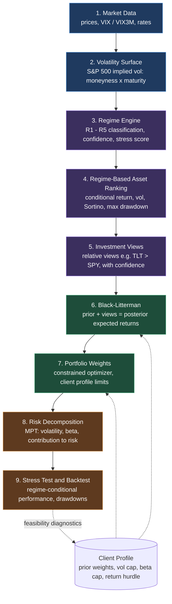

# Regime + Black-Litterman Portfolio Model

A volatility-aware portfolio research framework. It reads the market's risk regime from the S&P 500 implied volatility surface, turns that regime into relative investment views, and lets Black-Litterman decide how far the portfolio moves away from its equilibrium prior.

> [!warning]
> The default demo runs on **deterministic synthetic data**. It demonstrates the pipeline mechanics only. It is not real market performance and not an investment recommendation.

---

## Quick Start

**Run the demo in three commands:**

```bash
git clone https://github.com/<your-username>/<your-repo>.git && cd <your-repo>
pip install -r requirements.txt
python regime_bl_portfolio_model.py
```

**Run on real market data in three lines of Python:**

```python
from regime_bl_portfolio_model import ASSET_UNIVERSE, AGGRESSIVE, download_yfinance_data, run_backtest
market = download_yfinance_data(ASSET_UNIVERSE.keys(), start="2008-01-01")
print(run_backtest(market, AGGRESSIVE, start_backtest="2016-01-01").metrics)
```

Swap `AGGRESSIVE` for `LOW_VOL_SAVER` to run the capital-preservation profile.

---

## Architecture

The model is strictly hierarchical. Each layer only consumes the output of the layer above it.



**Design principle:** the regime engine is intentionally *not* an allocator. It only produces relative views. Black-Litterman controls how strongly those views tilt the portfolio away from equilibrium, according to the confidence assigned to each view.

---

## Client Profiles

### 1. Aggressive Investor

| Parameter | Default |
|---|---|
| Desired annual return | 14% |
| Return hurdle (75% of target) | 10.5% |
| Maximum volatility | 50% of current S&P 500 volatility |
| Maximum beta | 0.85 |
| Maximum equity weight | 75% |
| Minimum defensive allocation | 10% |

### 2. Low Volatility: Beat Savings

| Parameter | Default |
|---|---|
| Savings rate hurdle | 3.5% |
| Minimum return hurdle | 4.5% (savings + 1.0%) |
| Maximum volatility | 7% |
| Maximum beta | 0.35 |
| Maximum equity weight | 45% |
| Minimum defensive allocation | 45% |

These are starting parameters. When constraints cannot all be met at once, the optimizer reports `RELAXED_BEST_EFFORT` and quantifies the return, volatility and beta violations instead of claiming success. Replace the savings rate with the client's actual hurdle before use.

---

## Customising the Model

Edit the blocks at the top of `regime_bl_portfolio_model.py`:

| Block | Purpose |
|---|---|
| `ASSET_UNIVERSE` | Tickers available to the model |
| `AGGRESSIVE` | Aggressive client profile |
| `LOW_VOL_SAVER` | Low-volatility client profile |
| `EQUITY_GROUPS` | Which assets count as equity |
| `DEFENSIVE_GROUPS` | Which assets count as defensive |

The `prior_weights` inside each profile are the Black-Litterman prior, not the final portfolio.

---

## Data Modes

| Mode | Command | Use |
|---|---|---|
| Fast demo | `python regime_bl_portfolio_model.py` | Synthetic data, point-in-time snapshot, pipeline check |
| Real data | `download_yfinance_data(...)` + `run_backtest(...)` | Historical research via yfinance |

**Implied-volatility surface:** the script has a current option-chain hook and a 3D plot function. Backtesting the full moneyness x maturity surface historically needs point-in-time option chains. Without a professional options dataset, the historical regime backtest uses VIX / VIX3M plus additional stress proxies.

---

## Research Safeguards

- Point-in-time signal construction
- Next-day implementation after a rebalance signal
- Rolling covariance estimation
- Covariance shrinkage when scikit-learn is installed
- Transaction costs
- Explicit optimizer feasibility diagnostics
- Regime-conditional performance analysis
- Beta, Sharpe, Sortino, maximum drawdown, up/down capture, tracking error, information ratio and tail-loss metrics

---

## Documentation

- [[Math_description]]: full Black-Litterman derivation (reverse optimization, master formula, Idzorek confidence)
- [[Ideal_Model__BL_]]: model parameters and instrument selection
- [[Implying_a_Volatility_model]]: volatility regime concept
- [[regime_bl_demo_results]]: demo output on synthetic data
- [[Execution_according_to_client_profiles]]: client profile rationale

---

## Disclaimer

For research and education only. Nothing here is financial advice. Past or simulated performance does not predict future results.
